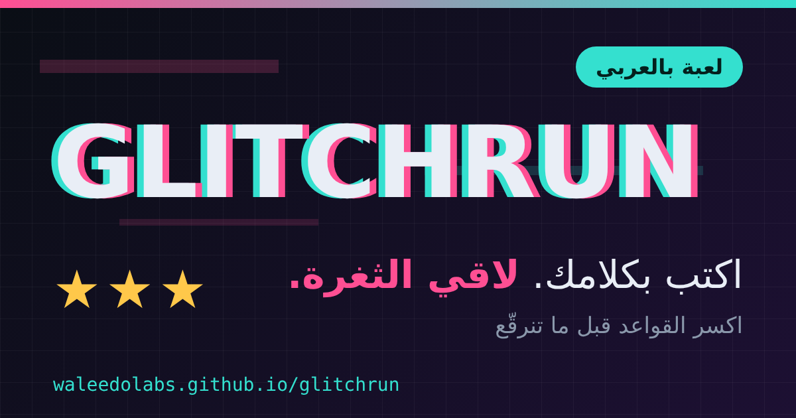
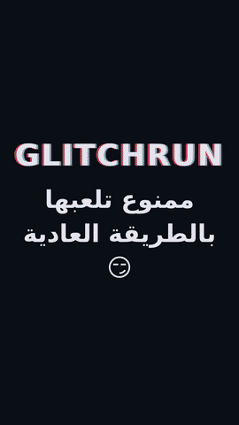

<div align="center">



# GLITCHRUN

**لعبة كتابة بالعربي: اكسر القواعد قبل ما تنرقّع.**
*A free-text Arabic browser game. Break the rules before they get patched.*

[](https://waleedolabs.github.io/glitchrun/)




[🎬 شوف الفيديو](promo.mp4)

</div>

---

## شو هي اللعبة؟

بتكون محبوس بمرحلة (غرفة، طابور فرن، قصر، مركب…) وهدفك تطلع منها بأقل عدد حركات.
**ما في أزرار ولا خيارات.** بتكتب شو بدك تعمل بكلامك: فصحى، عامية، أو فرانكو (`kasser el baab`).

- **سارد ذكي** بيحكي شو صار بلهجة سورية.
- **الكود هو الحكم.** السارد ما بيقرر مين ربح، قواعد ثابتة بالكود بتقرر. ما بتقدر تخدعه وتكتب "انتصرت".
- **كل ثغرة بتنكشف مرة وحدة.** لما تلاقي حيلة ذكية ما حدا فكر فيها، بتنكتب باسمك وبتنرقّع بالجولة الجاية، وبتاخد 💡.

## كيف تلعب (٣ خطوات)

1. **افتح** [الرابط](https://waleedolabs.github.io/glitchrun/). ما في تسجيل ولا تحميل.
2. **اكتب** شو بدك تعمل بالخانة تحت: `اطلع من الشباك`، `اشتري من جاري بسعر أعلى`، `خذ المفتاح وافتح الباب`.
3. **اربح** بأقل حركات. كل مرحلة بتعطيك نجوم (⭐⭐⭐ = بطل)، والمرحلة اللي بعدها بتنفتح.

### نصايح

| إذا علقت | جرّب |
|---|---|
| ما بعرف شو أعمل | زر **شو في بالغرفة؟** أو 💡 أول تلميح كل جولة ببلاش |
| الجواب غريب | اكتب أبسط وبجملة وحدة، فيك تكتب بالفرانكو |
| بدك نجمة زيادة | احفظ الحل وجرّب تعمله بحركات أقل |
| بدك تتحدى صاحبك | زر **شارك البطاقة** أو **واتساب**، الرابط بيحمل حيلتك |

## المراحل

الغرفة المقفلة · طابور الفرن · الملك · المركب · المكتبة · الفضاء · الامتحان
+ **تحدي يومي** جديد كل يوم وسلسلة أيام متتالية 🔥

المرحلتان الأولى والثانية مفتوحتان، والباقي بيفتح لما تحل اللي قبله.

## كيف بتشتغل؟ (للمطورين)

```
المتصفح (index.html)  ──►  Cloudflare Worker  ──►  نموذج لغوي (سارد + تقدير)
        │                      (توقيع الجولات، D1، حدود الاستخدام)
        └─ محرّك قواعد حتمي (deterministic) = الحكم النهائي
```

- ملف HTML واحد، بدون مكتبات. التقدّم محفوظ بـ`localStorage`.
- الـWorker بيوقّع الجولات (HMAC)، وبيحدّ الطلبات، وبيخزّن الأحكام بـD1.
- إذا الـAPI وقع، اللعبة بتكمّل بـ**وضع بسيط** محلي بدون سارد.

## الحالة

**MVP.** اللعبة شغالة وقابلة للعب بالكامل، لكن لسا بتتطور: تلميحات بالمشهد لكل ثغرة، مراحل جديدة، ولوحة متصدرين.
لقيت خطأ أو ثغرة؟ افتح [Issue](../../issues).

## شارك اللعبة

> لعبة عربية: اكتب بكلامك واكسر القواعد قبل ما تنرقّع 😈 جرّبها: https://waleedolabs.github.io/glitchrun/

<div align="center">

**GLITCHRUN** · صُنعت بحب من سوريا 🇸🇾

</div>
